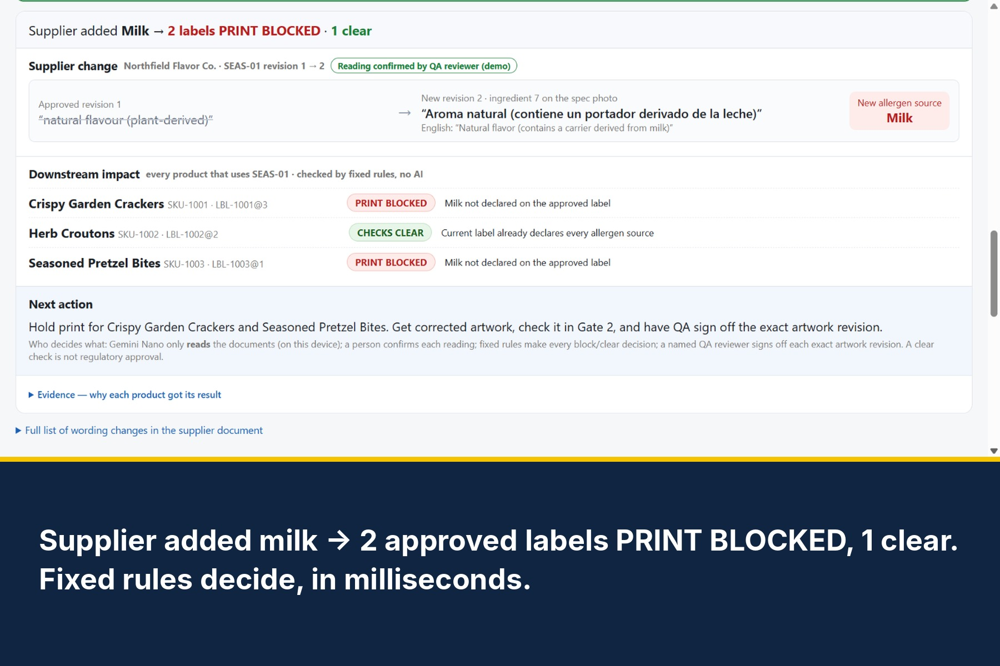

# LabelGate

### Catch a supplier ingredient change before the wrong allergen label is printed.

A supplier quietly changes an ingredient. Three of your products use it. Two of their approved labels no longer declare milk. **LabelGate finds every affected label and blocks the wrong ones before print.** Gemini Nano reads the confidential supplier document **on the device** through **Firebase AI Logic**, so it is never uploaded. Fixed rules decide, and a named QA reviewer confirms every reading and signs off every new artwork.

| | |
|---|---|
| **Live app** | https://protean-booth-470411-r7.web.app (problem → how it works → live demo) |
| **Live demo directly** | https://protean-booth-470411-r7.web.app/app/ |
| **Demo video (3 min)** | https://youtu.be/Hk8Kiy7bpMY |
| **Hackathon** | Google / Firebase **#BuildHybridAI 2026**, Web / Chrome |
| **License** | Apache-2.0 |



> All companies, products and documents in this repository are synthetic. LabelGate is a prototype for decision support; it is not a regulatory approval.

---

## Contents
1. [The problem](#1-the-problem)
2. [What LabelGate does](#2-what-labelgate-does)
3. [Try it (for judges)](#3-try-it-for-judges)
4. [How Firebase AI Logic is used](#4-how-firebase-ai-logic-is-used)
5. [Who decides what: the safety design](#5-who-decides-what-the-safety-design)
6. [Every feature](#6-every-feature)
7. [How LabelGate compares](#7-how-labelgate-compares)
8. [20 tests, including the ones that failed](#8-20-tests-including-the-ones-that-failed)
9. [How we built it](#9-how-we-built-it)
10. [Android: the private reading already runs on a real phone](#10-android-the-private-reading-already-runs-on-a-real-phone)
11. [Users, testers and limits](#11-users-testers-and-limits)
12. [Run it locally](#12-run-it-locally)
13. [Architecture and repository map](#13-architecture-and-repository-map)
14. [Built during the submission period](#14-built-during-the-submission-period)

---

## 1. The problem

A missing allergen on a label is not a typo. For a person with a food allergy it can mean the emergency room; for the manufacturer, a recall.

| | Fact | Source |
|---|---|---|
| **Law (U.S.)** | Food labels must identify the food source of all **9 major allergens** (milk, eggs, fish, crustacean shellfish, tree nuts, peanuts, wheat, soybeans, sesame). FDA treats a product with an undeclared major allergen as misbranded, subject to recalls, import refusal and seizure. | [FDA — Food Allergies](https://www.fda.gov/food/nutrition-food-labeling-and-critical-foods/food-allergies) |
| **Danger** | Every 10 seconds in the U.S., a food allergy reaction sends someone to the emergency room. 33 million Americans live with food allergy. | [FARE](https://www.foodallergy.org/media-room/fare-announces-support-american-center-cures) |
| **Frequency** | Undeclared allergens were the **#1 reason for U.S. food recalls in 2025: 38.8%** of 320 recalls. Milk was the most common undeclared allergen. | U.S. PIRG Education Fund, *Food for Thought 2026*, via [Statista](https://www.statista.com/chart/36281/fda-and-usda-food-recalls-in-the-united-states/) and [PIRG](https://pirg.org/edfund/media-center/report-fda-did-not-identify-product-to-recall-in-60-of-food-related-illness-outbreaks-in-2025/) |
| **Cost** | About **$10 million** in direct costs for an average recall, before lost sales and brand damage. | GMA / FMI / GS1 US study (2010), via [Food Dive](https://www.fooddive.com/news/more-than-money-what-a-recall-truly-costs/426855/) |
| **Root cause** | Australia's regulator counted **197 undeclared-allergen recalls in 2021–2025**. Among the causes it names: a supplier changes an ingredient and the change is not communicated, and label errors from incorrect translation or reformulation. | [FSANZ recall statistics](https://www.foodstandards.gov.au/food-recalls/recallstats) |

Two recent cases show the exact pattern LabelGate targets:
- **May 2026, USDA FSIS, Class I:** 71,603 lb of frozen dumplings recalled; made with peanut oil, peanut not on the label. The company said a formulation change led to the mislabeling ([Food Safety News](https://www.foodsafetynews.com/2026/05/35-tons-of-frozen-dumplings-recalled-because-of-undeclared-peanut-risk/)).
- **February 2025, FDA:** snacks recalled after a customer's allergic reaction; milk, egg and wheat undeclared because the supplier missed them while translating the ingredient list ([FDA notice](https://www.fda.gov/safety/recalls-market-withdrawals-safety-alerts/zb-importing-issue-voluntary-recall-and-allergy-alert-undeclared-egg-wheat-and-milk-certain-ulker)).

**Why it slips through:** the supplier document and the printed label live in different systems. Supplier specs arrive as photos or scans, sometimes in another language, and they are confidential, so teams are reluctant to upload them to cloud AI. Artwork proofreading compares new artwork with the *approved* text, so when the approved text itself is out of date, a wrong label still passes.

## 2. What LabelGate does

```
Supplier spec photo (EN/ES/JA)
        │  Gate 1 — Gemini Nano reads it ON THE DEVICE (Firebase AI Logic ONLY_ON_DEVICE)
        ▼
QA reviewer confirms the reading against the photo
        │  fixed rules, no AI, ~10 ms
        ▼
Supplier Change Impact Card ── every label that uses the ingredient:
        PRINT BLOCKED · NEEDS REVIEW · CHECKS CLEAR (awaiting sign-off)
        │  Gate 2 — corrected artwork read on device, neutral A/B questions
        ▼
QA signs off that exact artwork revision (SHA-256) → new verified label record
        │
        ▼
Hash-chained audit log (tamper test, JSON/CSV export)

Public recall notices → hybrid (PREFER_ON_DEVICE, cloud fallback) → matched to your formulas locally
```

Demo result with real Gemini Nano: **"Supplier added Milk → 2 labels PRINT BLOCKED · 1 clear"**, computed in 6–13 ms after the reading was confirmed.

## 3. Try it (for judges)

1. Open **https://protean-booth-470411-r7.web.app** in **desktop Chrome**. The first page checks whether your browser can run Gemini Nano. Click **Open the live demo**.
2. Click **▶ Start the 2-minute demo**. A yellow guide bar shows which button to press at each step:
   - **Gate 1:** read the Spanish supplier spec on device, check it against the photo, **Confirm this reading**. The Impact Card shows 2 labels PRINT BLOCKED, 1 clear.
   - **Gate 2:** open a blocked label, read the corrected artwork, answer the "which wording is printed?" questions, confirm, sign off.
   - **Review history:** see the hash-chained log; click **Test tamper detection**.
3. **Recall notices & text specs** tab: read a public recall notice with hybrid inference and match it to the formulas locally.
4. **Reset demo** (in Review history) restores the starting state.

**Requirements for on-device AI:** Chrome 148 or later on desktop, Gemini Nano available (16 GB RAM or a GPU with more than 4 GB VRAM, 22 GB free disk). On a laptop without a GPU each document read takes 30–90 s; the text streams in as it is read.
**Without Gemini Nano:** private documents are never sent to the cloud. Use **Type it myself (no AI)** to try every rule check; the recall notice uses the cloud fallback. No login needed.

## 4. How Firebase AI Logic is used

Firebase defines the two modes we use: `ONLY_ON_DEVICE` — "use the on-device model if it's available; otherwise, throw an exception"; `PREFER_ON_DEVICE` — "otherwise, fall back to the cloud-hosted model" ([Firebase AI Logic docs](https://firebase.google.com/docs/ai-logic/hybrid/web/configuration-options)). LabelGate chooses the mode **by how sensitive the data is** (`firebase` JS SDK 13.4, `firebase/ai`). All of it is in [`src/ai/firebase.js`](src/ai/firebase.js).

| Data | Example | Mode | Model | Why |
|---|---|---|---|---|
| **Private** document images | supplier spec photo, label artwork | `InferenceMode.ONLY_ON_DEVICE`, image + text, `en/es/ja`, JSON response constraint | Gemini Nano | Trade secrets. No cloud fallback. |
| **Private** text specs | spec text (second tab) | `InferenceMode.ONLY_ON_DEVICE` | Gemini Nano | Same rule |
| **Public** recall notices | a published recall | `InferenceMode.PREFER_ON_DEVICE`, JSON schema on both paths | Gemini Nano, else `gemini-3.5-flash-lite` in the cloud | Nothing confidential, so hybrid is safe |

The private path, with its privacy guard (from `src/ai/firebase.js`):

```js
const model = getGenerativeModel(ai, {
  mode: InferenceMode.ONLY_ON_DEVICE,
  onDeviceParams: { createOptions: DOC_CREATE, promptOptions: { responseConstraint: schema } },
});
const result = await model.generateContentStream([prompt, { inlineData: image }]);
for await (const chunk of result.stream) {
  if (chunk.inferenceSource && chunk.inferenceSource !== InferenceSource.ON_DEVICE)
    throw new Error(`privacy guard: inferenceSource was "${chunk.inferenceSource}"`);
  ...
}
```

The public, hybrid path:

```js
getGenerativeModel(ai, {
  mode: InferenceMode.PREFER_ON_DEVICE,
  onDeviceParams: { promptOptions: { responseConstraint: RECALL_SCHEMA } },
  inCloudParams: { model: "gemini-3.5-flash-lite",
    generationConfig: { responseMimeType: "application/json", responseSchema: RECALL_SCHEMA } },
});
```

### Which Gemini Nano model ran
On the web an app cannot choose the on-device model: Firebase AI Logic calls Chrome's Prompt API, and Chrome downloads the model variant it decides fits the hardware ([Chrome docs](https://developer.chrome.com/docs/ai/understand-built-in-model-management)). LabelGate's code does not depend on the model version. We checked `chrome://on-device-internals` on both test machines (screenshots in [`bench/results/chrome-model/`](bench/results/chrome-model/)):

| Machine | Used for | What Chrome shows |
|---|---|---|
| **AWS test VM** (Windows, Chrome 158, CPU only) | tests 1–3, including the 60 runs through Firebase AI Logic | "Gemma 4 for Built-in AI" flag on. The **version 4 model** is installed and ready: `gemma4_component` 2026.11.3.1140 *Ready*, `gemma4_cpu_model` 3,113 MiB, and the Prompt API use case `prompt_api_gemma4` *requested, available*. `nano_v3_cpu_model` is also installed. |
| **Laptop** (Intel integrated GPU, class "Low") | tests 4–18 and the demo video | `nano_v3_gpu_low_tier_model` installed, so these results ran on **Gemini Nano v3**. We switched on the Gemma 4 flag on Nov 27, but the download had not finished when we submitted. |
| **Galaxy S26** | test 19 | `nano-v3`; the newer `PREVIEW` option was unavailable on that phone. |

Also:
- **App Check** (reCAPTCHA Enterprise) protects the cloud path.
- **Warm-up:** when the page opens, Gemini Nano is loaded with a fixed one-word prompt (no document content). Cold start ≈ 38 s → warm ≈ 2 s.
- **Privacy evidence after every private read:** `inferenceSource` of every chunk plus every request the page made to another server during the read (Resource Timing API).
- **AI call log:** where each call ran (`on_device` / `in_cloud`), how long it took, and bytes sent to the cloud.

## 5. Who decides what: the safety design

| Gemini Nano **reads** | Fixed rules **decide** | A person **confirms** |
|---|---|---|
| Turns photos and artwork into text, on the device. Never decides whether a label is safe. | Deterministic check of 9 major U.S. allergens ([`src/proof/rules.js`](src/proof/rules.js)). | A named reviewer confirms every reading and signs off every artwork revision. |

- **Original-language matching.** Allergen words are matched in Spanish and Japanese too (leche, soja, 乳, 大豆, 小麦…), so a wrong English translation cannot hide an allergen. Look-alikes are excluded (leche de coco, 乳化剤).
- **What counts as declared.** An allergen counts as declared by its common name in the ingredient list, or by a complete "Contains" statement. "May contain" never counts. Facility or shared-line wording is never an ingredient.
- **The "Contains" line is found by a rule in the full reading**, not only in the model's field (this fixed a real failure, see test 4).
- **Nothing is decided on an unconfirmed reading.** An empty reading is retried once, then blocks confirmation. Placeholders ("Otros: no aplica"), mixed-alphabet words (`MALTOДЕКТРИН`) and moved "Contains" / "may contain" lines are flagged for the reviewer.
- **Differences become questions, not tick boxes.** Every place where the AI reading of new artwork differs from the approved label becomes a neutral question: "Which one does the artwork image say?" Both answers are shown in random order, styled the same, with nothing pre-selected. "I can't tell" sends the label to NEEDS REVIEW. This replaced tick boxes after a human test where 2 of 2 testers ticked through 6 of 6 planted errors (test 15).
- **Three outcomes, never "approved by AI":** `PRINT BLOCKED`, `NEEDS REVIEW`, `CHECKS CLEAR — AWAITING QA SIGN-OFF`.
- **Verified label library.** Each record holds the label text, the artwork's SHA-256, the reviewer, the date and the supplier revision it was approved against. A supplier change invalidates the old approval. An unchanged label can be re-approved for the new revision; new artwork always goes through Gate 2.
- **Tamper-evident log.** Every decision stores the SHA-256 of its content and of the previous entry, so editing, deleting or reordering an entry is detected. Hash-linked, not digitally signed; stored in the browser.

## 6. Every feature

| Area | Features |
|---|---|
| **Reading** | On-device reading of photographed specs and label artwork · English, Spanish, Japanese · live streaming text · empty-reading retry · placeholder and mixed-alphabet detection |
| **Rules** | 9 major U.S. allergens · original-language allergen words · look-alike exclusions · facility / shared-line wording handled · "Contains" and "may contain" found by rule |
| **Impact** | Supplier Change Impact Card with a one-line verdict · exact wording that changed and its location on the spec · every affected label re-checked in milliseconds · next action per label · who-decides-what note |
| **Review & sign-off** | Neutral A/B questions · "I can't tell" route to review · sign-off tied to the artwork fingerprint · re-approval of unchanged labels |
| **Audit** | Hash-chained log · **Test tamper detection** button · JSON / CSV export · verified label library |
| **Hybrid & platform** | Public recall notices on device or in the cloud · local matching to formulas · privacy evidence on every read · AI call log · model warm-up · works offline once open · guided 2-minute demo · "type it myself" mode without Nano · browser check on the landing page |
| **Android** | Native Kotlin app reading the same spec photos with Firebase AI Logic `ONLY_ON_DEVICE` on a real Galaxy S26 |

## 7. How LabelGate compares

Based on the vendors' own public product pages (November 2026). We have not tested these products; they are established tools with far wider scope than this prototype.

| Type of tool | Examples | What it does (vendor description) | What LabelGate adds |
|---|---|---|---|
| Artwork proofreading & label compliance | [GlobalVision](https://www.globalvision.co/industries/consumer-goods), [Esko Comply](https://www.esko.com/en/products/comply), [GoVisually](https://govisually.com/industries/food-and-beverage), [Artwork Flow](https://www.artworkflowhq.com/features/complyai) | Compare artwork with the approved master text; check artwork against rulebooks (allergen statements, font sizes, nutrition panels). | Starts from the **supplier change**. When the approved text itself is out of date, LabelGate finds it, so a wrong label cannot pass by matching an outdated master. |
| Supplier document & spec management | [TraceGains](https://newfoodmagazine.com/?p=249719), [Trustwell](https://www.food-safety.com/articles/10065-trustwell-adds-ai-powered-allergen-identification-feature-to-genesis-foods-software), [NSF TraQtion](https://www.nsf.org/th/en/traqtion/specification-management) | Collect supplier documents and extract data with AI in a cloud platform (TraceGains states it combines its data with an OpenAI model); recalculate allergen declarations for recipes. | Reads the confidential spec **on the device** with no cloud fallback, links it to **each approved label revision**, and **blocks print** until a person signs off the corrected artwork. |

## 8. 20 tests, including the ones that failed

Hardware: Zain's laptop (Chrome 158, Intel integrated GPU, no dedicated GPU), an AWS m5.xlarge Windows VM (CPU only), and real Samsung phones in Samsung Remote Test Lab. Synthetic documents only. For the main runs, expected outcomes and image hashes were frozen before the run.

| # | Test | What it checked | Result | Report |
|---|---|---|---|---|
| 1 | **Go / no-go on a cloud VM** | Does Gemini Nano run at all on a CPU-only AWS Windows VM? | GO: Nano runs on CPU (slowly). | [progress report](docs/labelgate-PROGRESS-REPORT-2026-11-26.md) |
| 2 | **Held-out benchmark v2** (AWS) | 20 new text specs × 3 runs: rules only vs Nano only vs hybrid | Nano raised recall on unfamiliar wording (0.19 → 0.56) but often named the wrong allergen. **Decision: the AI reads, rules decide.** | [B2 report](bench/results/B2-REPORT-2026-11-25.md) |
| 3 | **Held-out benchmark v3 + Firebase AI Logic path** | Fresh frozen cases after the redesign, then the same 60 runs through Firebase AI Logic | Hybrid identified 45/45 allergen-bearing ingredients, 0 silent misses; 60/60 Firebase calls OK; p50 27 s on CPU. | [v3 report](bench/results/V3-CHECKPOINT-REPORT-2026-11-26.md) |
| 4 | **Photo reading feasibility** | 22 photographed / rotated / blurred specs and labels, `ONLY_ON_DEVICE` | Allergens exactly right on **10/10 specs** (EN/ES/JA); 91.9% ingredient extraction; **22/22 on device, 0 outside requests**. Two safety failures (a "Contains" line read into the wrong field; one invented word) → fixed by rules. | [feasibility report](bench/specproof/SPECPROOF-GO-NOGO-2026-11-26.md) |
| 5 | **Acceptance set A** (10 frozen cases) | The real app path end to end | **Failed: 4/10**, every label blocked. Root causes ("plant" facility wording, placeholders) fixed with general rules. | [report](bench/acceptance/ACCEPTANCE-REPORT-2026-11-26.md) |
| 6 | **Acceptance set B** (6 fresh frozen cases) | Facility wording, ES placeholder, correct label, missing soy from a JA spec, ES whey/soy with no statement, a deliberately wrong reading | **7/7 as pre-registered**; 10/10 reads `on_device`; median 49 s (29–93 s). | [report](bench/acceptance/ACCEPTANCE-B-REPORT-2026-11-26.md) |
| 7 | **End-to-end with real Gemini Nano** | Gate 1 → impact → Gate 2 → sign-off | Spec read 60–111 s; impact on 3 labels in 6–13 ms; artwork read 53 s; label LBL-1001@4 signed off. | [update](bench/results/UPDATE-2026-11-26-evening.md) |
| 8 | **Hybrid fallback** | Public recall notice with and without Nano | With Nano: `on_device`, 43 s. Without Nano: `in_cloud`, 2.6 s, App Check OK. | [screenshots](bench/results/proof-evidence/) |
| 9 | **Offline** | Wi-Fi off after the page opened | Spec read on device 67 s, no outside requests; impact 6 ms; recall on device 39 s. | [report](bench/results/OFFLINE-TEST-2026-11-27.md) |
| 10 | **No Gemini Nano** (private document) | Is anything sent to the cloud? | The read stops; no outside requests; reviewer types the reading. | in-app |
| 11 | **Privacy evidence** | Servers contacted during every private read | `on_device` on every chunk; no outside requests during reads (App Check only at page start). | [screenshots](bench/results/firebase-evidence/) |
| 12 | **Model warm-up** | Does loading on page open help? | Cold 23.8 s + 14.2 s → warm 9 ms + 1.6 s. | [update](bench/results/UPDATE-2026-11-26-evening.md) |
| 13 | **Tamper detection** | Is an edited log entry detected? | Yes: "Audit chain broken at entry 8 — entry content was changed". | [update](bench/results/UPDATE-2026-11-26-evening.md) |
| 14 | **AI reviewer stand-in** (not a human) | Can a careful reader see the planted reading errors? | 3/3 caught, 1/1 correct reading accepted. | [report](bench/acceptance/AI-REVIEWER-STANDIN-2026-11-27.md) |
| 15 | **Human blind test 1** (2 people, tick boxes) | Does a person catch a confident but wrong AI reading? | **0/6 caught.** People ticked to move on. Design replaced. | [report](bench/reviewer-test/HUMAN-TEST-1-REPORT-2026-11-27.md) |
| 16 | **Human blind test 2** (1 new person, A/B questions) | Same, after the redesign | **3/3 caught**; 1 real change wrongly rejected. | [report](bench/reviewer-test/HUMAN-TEST-2-REPORT-2026-11-27.md) |
| 17 | **Independent comprehension review** of the Impact Card (in progress) | Can a first-time reader understand the card in about a minute? | First reviewer: 4/5 correct, rated 5/5 easy and 5/5 useful. The unclear term ("CHECKS CLEAR") is now explained on the card. | [report](bench/expert/EXPERT-REVIEW-2026-11-27.md) |
| 18 | **Reading errors seen live** while filming | — | Nano wrote `MALTOДЕКТРИН` (Cyrillic letters) and `MACTODEXTRIN`; the reviewer caught both. A new rule flags mixed-alphabet words. | [screenshot](bench/results/proof-evidence/nano-mixed-script-glitch-2026-11-27.png) |
| 19 | **Android on real phones** | Same private reading in a native app, Samsung Remote Test Lab | Galaxy S26: full Spanish spec read **on the phone in 12.2 s**, same ingredients and statement as Chrome, 0 bytes sent by the app. S25 / S26+ without Nano: stopped safely. | [report](bench/android/ANDROID-NANO-CHECK-2026-11-27.md) |
| 20 | **Automated tests** | Rules, original-language words, retry, audit chain, hybrid wiring, A/B questions, full UI flow | **151 passing** (`npm test`) | [`test/`](test/) |

**What these tests do not show:** an error rate on real supplier documents (all cases are synthetic and few); a factory deployment or multi-user use; zero network traffic for a whole phone (test 19 counts only the app's own bytes); a signed or server-side audit record (the log is hash-linked in the browser). Each report states its own scope.

What the failures changed: test 2 made Gemini Nano a reader instead of a judge; tests 4 and 5 added rule-based "Contains", facility and placeholder handling; test 15 replaced tick boxes with A/B questions; test 17 added the CHECKS CLEAR explanation; test 18 added the mixed-alphabet check. A one-page summary is in [`bench/TEST-SUMMARY-2026-11-27.md`](bench/TEST-SUMMARY-2026-11-27.md).

## 9. How we built it

| Date (2026) | Stage | What happened |
|---|---|---|
| Nov 25 | **Does Nano run at all?** | Gemini Nano tested on a CPU-only AWS Windows VM (go / no-go), then benchmarked on held-out cases against a rules-only baseline. Nano read unfamiliar wording well but could not be trusted to classify, so it became the reader, not the judge. |
| Nov 26 | **The real Firebase path** | Firebase AI Logic, App Check and Hosting connected; the benchmark repeated through Firebase AI Logic (60/60). Photo reading proven on the laptop (22/22 on device). Acceptance set A failed; root causes fixed; fresh set B passed 7/7. Hybrid recall notices added and tested both ways. |
| Nov 27 | **People, offline, Android** | Two human blind tests (the first failed and forced a redesign), offline test, a live reading glitch turned into a rule, the Android reading on a real Galaxy S26 via Samsung Remote Test Lab, independent comprehension reviews, the website and the demo video. |

Tools used: Firebase AI Logic (JS and Android SDKs), Firebase Hosting, App Check with reCAPTCHA Enterprise, Chrome built-in AI, Vite, Vitest, Kotlin, AWS EC2 (test VM), Samsung Remote Test Lab. Code was written with an AI coding assistant; every number in this README comes from a real run whose report is linked above.

## 10. Android: the private reading already runs on a real phone

The full LabelGate workflow runs in Chrome today. To prove that its most sensitive step, reading a confidential supplier spec photo with no cloud fallback, also works on Android, we built a native app in [`android-experimental/`](android-experimental/). It uses the Firebase AI Logic Android SDK (`firebase-ai` 18.2.0 + `firebase-ai-ondevice`) with `InferenceMode.ONLY_ON_DEVICE` and the same prompt as the web app. We ran it on real Samsung phones through Samsung Remote Test Lab.

| Phone | Gemini Nano | Private photo read | Sent by the app |
|---|---|---|---|
| Galaxy S26, Android 16 | available after a 4.2 GB model download (`nano-v3`) | on the phone; full Spanish reading in 12.2 s, same ingredients and allergen statement as Chrome | 0 bytes |
| Galaxy S25 (one lab unit) | not available (AICore missing or too old) | stopped with an error | nothing (no cloud fallback) |
| Galaxy S26+ (US model, one lab unit) | not available | stopped with an error | nothing (no cloud fallback) |

Evidence: phone screenshots and a screen recording in [`bench/android/evidence/`](bench/android/evidence/). "0 bytes" is the app's own count of data it sent during the read (Android `TrafficStats`), not a separate network capture. **Next:** bringing the Impact Card, artwork check, sign-off and audit log to the Android app.

## 11. Users, testers and limits

**Users:** no public users yet. People have used it in blind reviewer tests (3) and comprehension reviews (ongoing). The next step is a pilot with a food manufacturer's QA team.

**Limits we state openly:**
- **Speed:** 30–90 s per document read on a laptop without a GPU. One read per supplier change; the impact on every label is then instant.
- **Small, synthetic test sets** and few human testers: usability and integration signals, not accuracy claims. No real supplier PDFs yet (images only).
- **Reading errors:** Nano can misspell. Mixed alphabets are caught automatically; a plain misspelling is caught only by the reviewer, which is why a person confirms every reading.
- **Human step:** the A/B design caught 3/3 with one new tester, who also rejected one real change. No interface can force a person to look.
- **Offline** works once the page is open; there is no offline install.
- **Scope:** simplified U.S. major-allergen rules; single user, browser storage; no server-side audit store.

## 12. Run it locally

```bash
git clone https://github.com/Gosho1992/labelgate && cd labelgate
npm install
cp .env.example .env.local   # Firebase web config + reCAPTCHA Enterprise site key (see comments in the file)
npm run dev                  # http://localhost:5173  (/ = landing, /how/ = how it works, /app/ = the demo)
npm test                     # 151 tests
npm run build && npx firebase deploy --only hosting
```

Firebase setup: create a Firebase project, enable **Firebase AI Logic** (Gemini Developer API), register a web app, and enable **App Check** with reCAPTCHA Enterprise. For local development App Check can use a debug token (`VITE_APPCHECK_DEBUG=1`); register it in the Firebase console and never commit it. Gemini Nano needs desktop Chrome 148+ on a capable device.

Android check app: open `android-experimental/` in Android Studio, add your own `app/google-services.json` (not committed), build, and run on a phone with Gemini Nano (AICore).

## 13. Architecture and repository map

- `index.html`, `how/index.html`: the landing pages (problem, how it works, tests). `src/site.css`.
- `app/index.html`: the live demo app.
- `src/ai/firebase.js`: every Firebase AI Logic model and its inference mode, App Check, warm-up, privacy guard.
- `src/proof/`: the main app.
  - `ui.js`: Gate 1 / Gate 2 / Impact Card / history.
  - `read.js`: on-device reading and retry.
  - `rules.js`: deterministic allergen checks.
  - `library.js`: verified label records, re-approval, diffs.
  - `verify.js`: the A/B verification questions.
  - `audit.js`: hash chain and tamper test.
  - `privacy.js`: network evidence.
- `src/ai/extract.js`, `src/engine/`, `src/allergens/`: the second tab (text specs and recall matching).
- `test/`: 151 automated tests.
- `bench/`: frozen test sets, raw model outputs and every report linked above. `bench/android/`: the Android check.
- `android-experimental/`: native Android app (Kotlin, Firebase AI Logic on-device).
- `public/expert/`: the comprehension review page used in test 17.
- `demo/`: scripts that render the synthetic documents.
- Development harness pages: `acceptance.html`, `acceptance-b.html`, `specproof.html`, `privacy-test.html`, `bench.html`, `reviewer-test.html`.

## 14. Built during the submission period

LabelGate is a new project, started on Nov 25, 2026. All code in this repository was written during the submission period. One idea predates the hackathon: the multi-objective routing formula in `src/engine/router.js` was designed before Nov 11; its code was written during the period.

## License

Apache-2.0. See [LICENSE](LICENSE).
